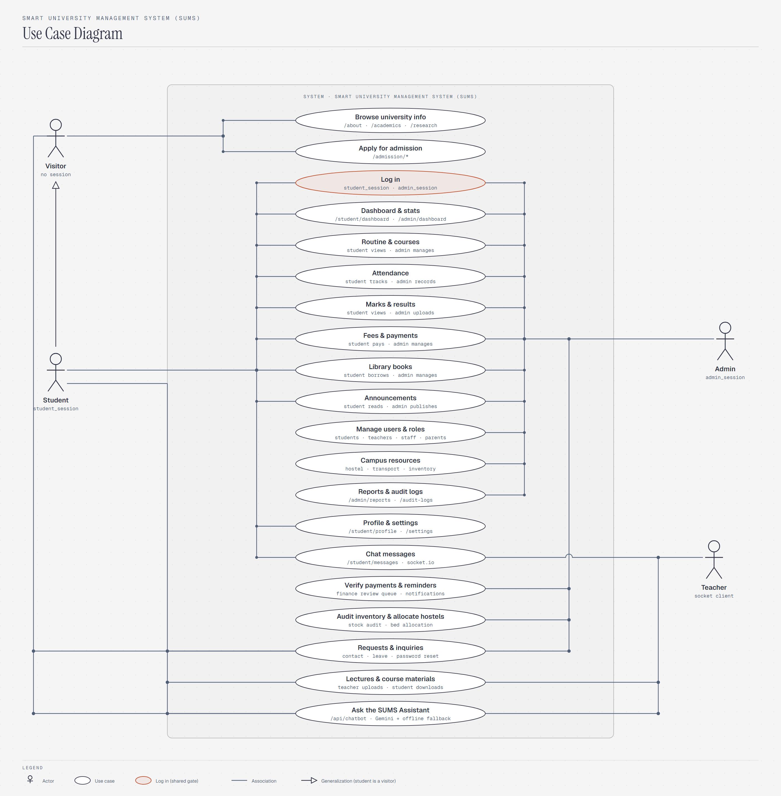
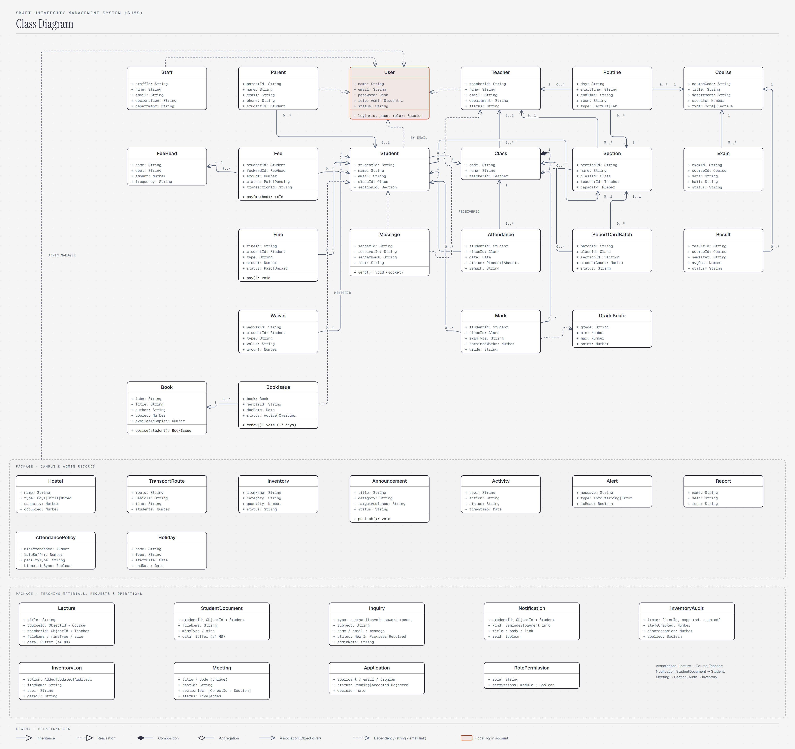
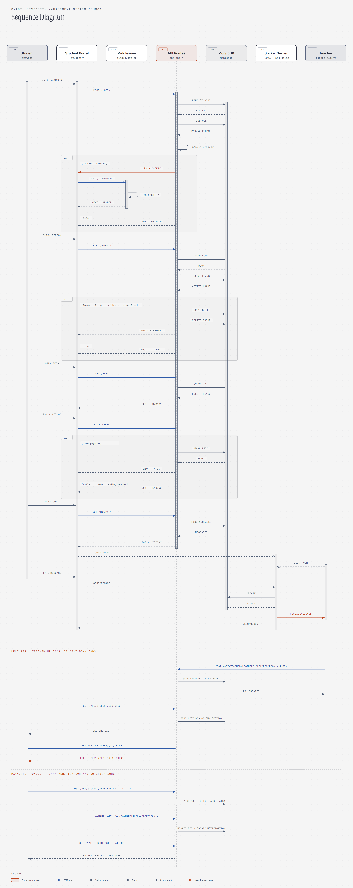
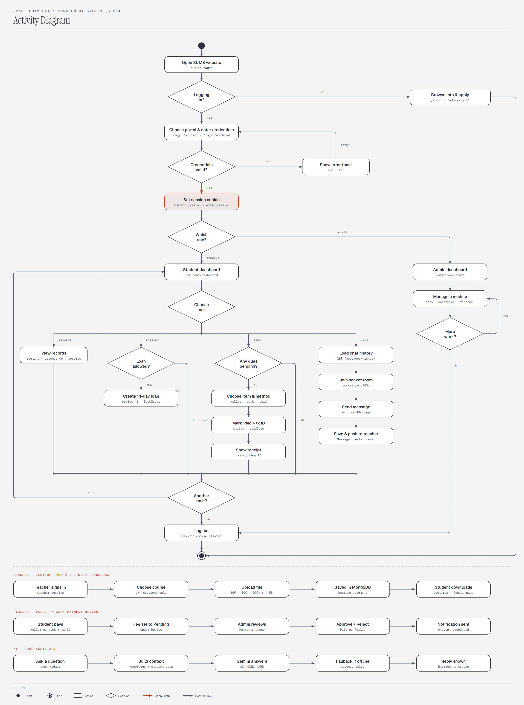

# 🎓 Smart University Management System (SUMS)
## Comprehensive Software Engineering & System Architecture Documentation

---

## 📑 Table of Contents
1. [Executive Summary & Vision](#1-executive-summary--vision)
2. [Project Scope & Objectives](#2-project-scope--objectives)
3. [System Requirements Specification](#3-system-requirements-specification)
4. [Architecture & Technology Stack](#4-architecture--technology-stack)
5. [Comprehensive UML System Diagrams](#5-comprehensive-uml-system-diagrams)
   - [5.1 Use Case Diagram](#51-use-case-diagram-system-interactions--actor-scopes)
   - [5.2 Class Diagram](#52-class-diagram-data-entities--structural-topology)
   - [5.3 Sequence Diagram](#53-sequence-diagram-end-to-end-student-session-lifecycle)
   - [5.4 Activity Diagram](#54-activity-diagram-operational-workflow--decision-gateways)
6. [Data Architecture & Mongoose Schema Catalog](#6-data-architecture--mongoose-schema-catalog)
7. [API Endpoints & Real-Time Socket Protocol](#7-api-endpoints--real-time-socket-protocol)
8. [Security & Role-Based Access Control (RBAC)](#8-security--role-based-access-control-rbac)
9. [Installation & Deployment Guide](#9-installation--deployment-guide)

---

## 1. Executive Summary & Vision

The **Smart University Management System (SUMS)** is an enterprise-grade cloud web application developed to streamline, digitize, and centralize all academic, administrative, and financial functions across modern higher education institutions.

Built on an advanced modern technology stack combining **Next.js 15+ (App Router)**, **React 19**, **Tailwind CSS 4.0**, **MongoDB / Mongoose 8.x**, and a dedicated **Socket.io** WebSocket engine, SUMS eliminates fragmented departmental tools and paper-heavy workflows in favor of a responsive, real-time, role-governed digital campus.

### Core Institutional Benefits:
* **Academic Automation:** End-to-end scheduling of classes and routines, dynamic transcript generation, and policy-driven attendance tracking.
* **Financial Governance:** Transparent tuition and fee billing, automated receipt issuance, fee waivers, and overdue fine management.
* **Role-Based Portals (RBAC):** Tailored dashboards and access controls for Administrators, Teachers, Students, Staff, and Parents.
* **Integrated Campus Services:** Modern digital library borrowing system, hostel bookings, transportation fleet routes, and real-time student-faculty chat.

---

## 2. Project Scope & Objectives

### Strategic Goals:
1. **Unified Campus Ledger:** Maintain a single authoritative source of truth for student records, academic progress, faculty assignments, and financial transactions.
2. **Operational Efficiency:** Enable zero-paper workflows for student admissions, course enrollments, grade submissions, and fee collections.
3. **High-Availability Self-Service:** Provide students with round-the-clock access to attendance statistics, grades, routines, library status, and payment receipts.
4. **Sub-Second Real-Time Interaction:** Foster immediate classroom communication via bi-directional WebSocket messaging between students and professors.

---

## 3. System Requirements Specification

### 3.1 Functional Requirements
* **Identity & Role-Based Access Control (RBAC):**
  - Multi-portal authentication (`POST /api/auth/login`, role `Admin` | `Employee` (teacher) | student) with bcrypt-verified passwords.
  - Cookie-based portals for Admin (`admin_session`), Student (`student_session`) and Teacher (`teacher_session`) enforced at the edge; Staff and Parent exist as records/roles without a login portal. Per-role module permissions are editable by admins and stored in `RolePermission`.
* **Academic Curriculum Management:**
  - Full CRUD operations for Classes, Courses, Sections, and weekly Lecture/Lab Routines.
  - Classroom capacity limits, teacher allocations, and schedule collision prevention.
* **Attendance Tracking & Policy Compliance:**
  - Daily roll-call logging with automated absenteeism percentages calculated against university policies (`AttendancePolicy`).
* **Examinations & Automated Transcripts:**
  - Batch uploading of marks, automated GPA/CGPA computation, and dynamic transcript compilation.
* **Financial Invoicing & Payment Engine:**
  - Dynamic invoice generation for tuition and fees, waiver discounts, overdue fine calculations, and transaction verification.
* **Digital Library Operations:**
  - ISBN cataloging, physical copy availability tracking, 14-day borrowing controls, and renewal management.
* **Real-Time Communication:**
  - Instant direct and classroom chat channels with message history persistence in MongoDB.
  - Live-class (WebRTC) meeting chat is persisted in the raw `meetingmessages` collection written by the socket server (not a Mongoose model).
* **Teaching Materials (Lectures):**
  - Teachers upload lecture files (PDF, DOC, DOCX, max 4 MB) per course and section; files are stored in MongoDB (`Lecture`). Students see and download only the lectures of their own section's courses (Lectures, Downloads and each Course page).
* **Per-Course Marks & CGPA:**
  - One mark per student, course and assessment (Quiz 20, Assignment 20, Midterm 30, Final 50); saving again updates it (upsert). Results are credit-weighted against `GradeScale` (`lib/gpa.ts`). Admins can upload marks (including CSV) and check graduation clearance (no dues, no unreturned books, results present).
* **Requests, Inquiries & Student Documents:**
  - Contact/feedback/password-reset/leave requests are stored in `Inquiry` and handled in Admin > Inquiries. Students keep personal documents (`StudentDocument`) and print an ID card.
* **Payment Verification & Notifications:**
  - Card payments are marked `Paid` instantly; mobile-wallet/bank payments are `Pending` (Under Review) with a transaction ID until finance approves or rejects them. Every decision and every fee reminder creates a `Notification` shown on the student dashboard.
* **Campus Operations:**
  - Admin CRUD for students, staff, parents and users; inventory with unit prices, audit sessions (`InventoryAudit`) and stock logs (`InventoryLog`); hostel bed allocation per student; global search across the dashboards; dark mode.
* **SUMS Assistant (Chatbot):**
  - `POST /api/chatbot` answers questions for anyone. The server builds the prompt from the university knowledge base plus, for a signed-in student, that student's real attendance, fees, results and courses. Engine order: Gemini (`GEMINI_API_KEY`, `AI_MODEL_NAME`), optional Claude, then an offline keyword fallback.
* **Currency:** all amounts are in Egyptian pounds (EGP).

### 3.2 Non-Functional Requirements
* **Performance:** Sub-second page loads powered by Next.js Server-Side Rendering (SSR) and edge-based routing.
* **Security:** Cryptographic password hashing via `bcryptjs`, tamper-resistant session cookies, and strict Mongoose schema typing to guard against injection.
* **Scalability:** Indexed MongoDB collections designed to scale to tens of thousands of active student records.
* **Accessibility & Responsiveness:** Intuitive, WCAG-compliant UI adapting seamlessly across mobile phones, tablets, and desktop workstations.

---

## 4. Architecture & Technology Stack

| Layer / Concern | Technology | Purpose & Implementation Details |
| :--- | :--- | :--- |
| **Frontend Framework** | **Next.js 16 / React 19** | App Router utilizing React Server Components for zero client JS overhead and fast rendering. |
| **Styling & Animation** | **Tailwind CSS 4.0 & Framer Motion** | Utility-first styling with high-contrast accessibility and smooth UI transitions. |
| **Edge Protection** | **Next.js Middleware (`middleware.ts`)** | Intercepts protected `/admin/*`, `/student/*` and `/teacher/*` routes to validate session tokens before page execution. |
| **Backend REST APIs** | **Next.js Route Handlers (`app/api/*`)** | Lightweight, type-safe API endpoints handling business logic and database mutations. |
| **Persistence Tier** | **MongoDB & Mongoose** | Document database with 40 strictly typed schemas, automated timestamps, and referenced integrity. |
| **Real-Time Engine** | **Socket.io (`socket-server.js`)** | Standalone Node.js WebSocket process (Port 3001) for instant message dispatch and channel subscriptions. |
| **Type Safety** | **TypeScript 5.x** | Compile-time validation preventing runtime exceptions across data structures. |

---

## 5. Comprehensive UML System Diagrams

All UML diagrams have been drafted, verified, and exported into standalone **Vector PDF** (for high-resolution printing and formal submissions) and **2x High-Resolution PNG** formats.

---

### 5.1 Use Case Diagram (System Interactions & Actor Scopes)

Defines system boundaries and the direct associations between actors and university use cases:
* **Visitor:** Explore university public portals, browse programs, submit admission applications.
* **Student:** Log in, monitor academic dashboard, track attendance, view transcripts, settle fees, borrow library books, and participate in chat.
* **Admin:** Institutional governance, user management, academic setup, financial approvals, announcements, and campus audit logs.
* **Teacher:** Log in through the Employee portal (`teacher_session`), view the weekly routine, courses and students of assigned sections, record attendance, enter marks, publish student announcements, and chat with students.

#### 🖼️ Visual Preview:


* 📄 **Download Vector PDF:** [uc-sums.pdf](./diagrams/pdf/uc-sums.pdf)
* 🌐 **Interactive Diagram View (HTML):** [use-case-diagram.html](./diagrams/use-case-diagram.html)

---

### 5.2 Class Diagram (Data Entities & Structural Topology)

A structural blueprint encompassing all **40 Mongoose models** located in `models/`, complete with attributes, types, operations, and relational semantics:
* **Authentication Package:** `User` serving as the focal authentication gate with 1-to-1 links to `Student`, `Teacher`, `Staff`, and `Parent`.
* **Academic Package:** `Course`, `Class`, `Section`, `Routine`, `Exam`, `Mark`, `Result`, and `GradeScale`.
* **Financial Package:** `FeeHead`, `Fee`, `Waiver`, and `Fine`.
* **Library Package:** `Book` and `BookIssue`.
* **Real-Time Communication:** `Message`, `Meeting`.
* **Teaching, Requests & Operations Package:** `Lecture`, `StudentDocument`, `Inquiry`, `Notification`, `InventoryAudit`, `InventoryLog`, plus `Application` (admission applications) and `RolePermission`.
* **Campus & Admin Records Package:** `Hostel`, `TransportRoute`, `Inventory`, `Announcement`, `Activity`, `Alert`, and `Report`.

#### 🖼️ Visual Preview:


* 📄 **Download Vector PDF:** [cls-sums.pdf](./diagrams/pdf/cls-sums.pdf)
* 🌐 **Interactive Diagram View (HTML):** [class-diagram.html](./diagrams/class-diagram.html)

---

### 5.3 Sequence Diagram (End-to-End Student Session Lifecycle)

Demonstrates a sequential, chronological session tracing interactions across client, network edge, backend API, database, and WebSocket tiers:
1. **Authentication:** Submits credentials, compares hash via `bcrypt.compare`, sets `student_session` cookie.
2. **Edge Route Gate:** Next.js `middleware.ts` validates cookie presence and forwards to dashboard.
3. **Library Borrowing:** Validates loan quota (< 5 active loans) and decrements available copies.
4. **Fee Payment:** Fetches dues, marks record as `Paid`, and stores transaction identifier.
5. **Live Chat Dispatch:** Joins WebSocket room on port 3001, sends message payload, persists in MongoDB, and broadcasts to instructor.

#### 🖼️ Visual Preview:


* 📄 **Download Vector PDF:** [seq-sums.pdf](./diagrams/pdf/seq-sums.pdf)
* 🌐 **Interactive Diagram View (HTML):** [sequence-diagram.html](./diagrams/sequence-diagram.html)

---

### 5.4 Activity Diagram (Operational Workflow & Decision Gateways)

Models the end-to-end operational control flow from initial landing through authentication decision diamonds, role forks, parallel student task workflows (with retry and completion loops), and clean session termination:

#### 🖼️ Visual Preview:


* 📄 **Download Vector PDF:** [act-sums.pdf](./diagrams/pdf/act-sums.pdf)
* 🌐 **Interactive Diagram View (HTML):** [activity-diagram.html](./diagrams/activity-diagram.html)

---

## 6. Data Architecture & Mongoose Schema Catalog

Key schema structures from the 40 entities defined in `models/`:

### 1. `User.ts` (Core Identity)
| Field | Type | Modifiers / Constraints | Description |
| :--- | :--- | :--- | :--- |
| `name` | `String` | Required, Trimmed | Full display name |
| `email` | `String` | Required, Unique, Lowercase | Unique login identifier |
| `password` | `String` | Required | Salted bcrypt hash |
| `role` | `Enum` | `Admin` \| `Student` \| `Teacher` \| `Staff` \| `Parent` | System access role |
| `status` | `String` | Default: `Active` | Account status indicator |

### 2. `Student.ts` (Academic Profile)
| Field | Type | Modifiers / Constraints | Description |
| :--- | :--- | :--- | :--- |
| `studentId` | `String` | Required, Unique | Institutional matriculation ID |
| `name` / `email` | `String` | Required | Contact details |
| `classId` | `ObjectId` | Ref: `Class` | Primary enrolled class |
| `sectionId` | `ObjectId` | Ref: `Section` | Academic section group |

### 3. `Fee.ts` (Financial Invoicing)
| Field | Type | Modifiers / Constraints | Description |
| :--- | :--- | :--- | :--- |
| `studentId` | `ObjectId` | Ref: `Student` | Charged student |
| `feeHeadId` | `ObjectId` | Ref: `FeeHead` | Fee classification |
| `amount` | `Number` | Min: 0 | Billable amount |
| `status` | `Enum` | `Paid` \| `Pending` | Payment state |
| `transactionId` | `String` | Optional | Bank/gateway receipt ID |

### 4. `Lecture.ts` (Teaching Materials)
| Field | Type | Modifiers / Constraints | Description |
| :--- | :--- | :--- | :--- |
| `title` | `String` | Required | Lecture title |
| `courseId` / `sectionId` | `ObjectId` | Ref: `Course` / `Section` | Target course and section |
| `teacherId` | `ObjectId` | Ref: `Teacher` | Uploader |
| `fileName` / `mimeType` / `size` | `String` / `String` / `Number` | PDF, DOC, DOCX, max 4 MB | File metadata |
| `data` | `Buffer` | Required | File content stored in MongoDB |

### 5. `Mark.ts` (Per-Course Marks)
| Field | Type | Modifiers / Constraints | Description |
| :--- | :--- | :--- | :--- |
| `studentId` / `courseId` | `ObjectId` | Unique with `examType` | One mark per student, course, assessment |
| `examType` | `Enum` | `Quiz` \| `Assignment` \| `Midterm` \| `Final` | Assessment |
| `obtainedMarks` / `totalMarks` | `Number` | 0 ≤ obtained ≤ total | Score |
| `grade` | `String` | From `GradeScale` | Letter grade |

### 6. `Inquiry.ts`, `Notification.ts`, `StudentDocument.ts`, `InventoryAudit.ts`, `InventoryLog.ts`
* `Inquiry`: public/student request (kind, name, email, message, status `New` → `Resolved`).
* `Notification`: per-student message (`title`, `kind` such as `reminder` or `payment`, read flag).
* `StudentDocument`: personal files of a student.
* `InventoryAudit` / `InventoryLog`: counted-versus-recorded stock sessions and stock movement history.

---

## 7. API Endpoints & Real-Time Socket Protocol

### 7.1 Primary REST Endpoints
* `POST /api/auth/login`: Validates credentials (`role`: `Admin`, `Employee` for teachers, otherwise student) and sets the matching session cookie. Logout clears the cookie (`POST /api/teacher/logout` for teachers; client-side cookie clear for admin/student).
* `GET /api/admin/stats`: Compiles dashboard metrics (students, faculty, classes, fees).
* `POST /api/admin/students`: Registers and provisions a new student record.
* `POST /api/admin/marks`: Ingests and processes examination marks.
* `POST /api/student/library/borrow` and `/renew`: Issue or renew a library book after verifying availability and loan limits.
* `GET/POST /api/student/fees`: Lists dues and records payments with a transaction ID.
* `POST /api/admission/apply`: Public admission application (stored in `applications`); `GET/PATCH /api/admin/applications` lets admins review and decide.
* `GET/PUT /api/admin/roles`: Live per-role user counts and editable module permissions.
* `GET /api/admin/settings`: Live database statistics and health.
* `GET /api/teacher/dashboard`, `GET/POST /api/teacher/attendance`, `GET/POST /api/teacher/marks`, `POST /api/teacher/announcements`, `GET /api/teacher/messages/{contacts,history}`: Teacher portal (all scoped to the teacher's own sections).

* `GET/POST /api/student/lectures`, `GET /api/lectures/[id]/file`, `GET/POST /api/teacher/lectures`: Upload and download lecture files with section-based access checks.
* `GET /api/student/{dashboard,results,notifications,documents,profile}`, `GET /api/student/courses/[id]`: Student portal data, always the signed-in student's own records.
* `POST /api/admin/marks`: Upsert of per-course marks; `GET /api/admin/marks/clearance`: graduation clearance status.
* `GET/PATCH /api/admin/financial/payments`: Review queue (approve/reject wallet and bank payments); `POST /api/admin/financial/reminders`: send fee reminders.
* `GET/POST/PUT/DELETE /api/admin/{students,staff,parents,users,inventory}` (+ `/[id]`), `POST /api/admin/inventory/audit`, `POST /api/admin/hostels/allocate`.
* `POST /api/inquiries` (public), `GET/PATCH /api/admin/inquiries`: Requests and inquiries.
* `POST /api/chatbot`: SUMS Assistant. `GET /api/auth/me`: current session identity.

### 7.2 WebSocket Events (`socket-server.js`)
* `join`: Subscribes a client socket to its private room (student ID or teacher ID).
* `sendMessage`: Persists a chat message and dispatches it to the receiver's room.
* `receiveMessage` / `messageSent`: Delivery to the receiver and acknowledgement to the sender.
Run the socket server with `npm run chat` (port 3001).

---

## 8. Security & Role-Based Access Control (RBAC)

1. **Edge Middleware (`middleware.ts`):** Evaluates HTTP requests before page rendering or route handler execution, enforcing session token requirements.
2. **Encrypted Passwords:** User passwords undergo multi-round cryptographic salting via `bcryptjs`.
3. **NoSQL Injection Mitigation:** Input values are strictly sanitized and bound by Mongoose schema validators.
4. **API Guard:** `middleware.ts` also protects every `/api/admin/*` route; admin handlers additionally call `getAdminContext()`. Student and teacher APIs resolve the signed-in user from the session cookie and scope all queries to that user.
5. **Known limitation:** session cookies hold plain identifiers rather than signed tokens; use signed sessions (e.g. JWT) before a public deployment.
6. **CORS & WebSocket Partitioning:** The Socket server currently allows any origin (`*`); restrict it to the production origin before deployment.

---

## 9. Installation & Deployment Guide

### Prerequisites
- **Node.js**: Version 18.x or higher (LTS 20 or 22 recommended).
- **MongoDB**: Local database or MongoDB Atlas connection string.

### Quickstart Commands
```bash
# 1. Install dependencies
npm install

# 2. Configure environment parameters in .env.local
# MONGODB_URI=mongodb://localhost:27017/sums_db   (or a MongoDB Atlas connection string)

# GEMINI_API_KEY=...   AI_MODEL_NAME=...   (chatbot; works offline without them)

# 3. (Optional) Fill the empty database with demo data - never deletes existing data
npm run seed

# 4. Launch WebSocket daemon (Port 3001)
npm run chat

# 5. Start Next.js application (Port 3000)
npm run dev
```

### Deployment (GitHub + Vercel)
* **Website and API:** push to GitHub and import the repository in Vercel (`vercel.json` is included). Set `MONGODB_URI` (and optionally `GEMINI_API_KEY`, `AI_MODEL_NAME`, `NEXT_PUBLIC_SOCKET_URL`, TURN variables) in the project's environment variables, and allow Vercel in MongoDB Atlas Network Access (`0.0.0.0/0`).
* **Socket server:** Vercel cannot host WebSockets, so `socket-server.js` runs on a separate host (Render, Railway, Fly.io) with `MONGODB_URI` and `ALLOWED_ORIGIN`; its URL is given to the website as `NEXT_PUBLIC_SOCKET_URL`.
* **Upload limit:** lecture files and student documents are limited to 4 MB because Vercel serverless request bodies are capped at 4.5 MB.

---

> 🎓 **SUMS Engineering & Architecture Documentation** — Verified and fully referenced for academic and enterprise submission.
